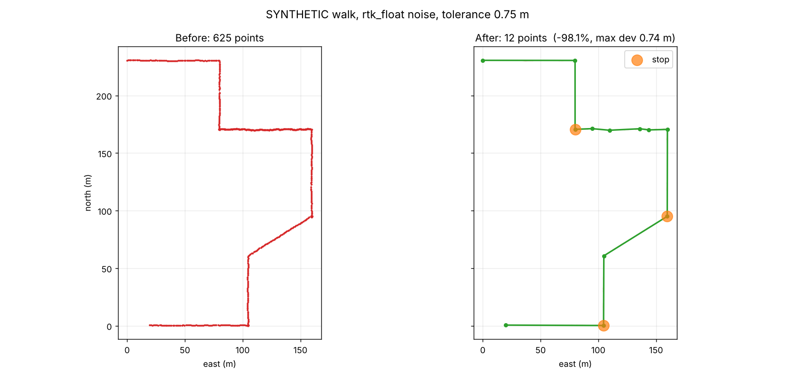

# GPS Track Optimizer

Cleans recorded pedestrian GPS/RTK traces: removes the cloud of points created
while the walker stands still, simplifies straight stretches with
Douglas–Peucker, and **measures what that cost in accuracy**.

Built as a prototype for the "too many points in recorded traces" problem in
pedestrian navigation for blind and visually impaired users.

> All results in this repository so far come from **synthetic** walks with a
> known true path. See `REPORT.md` for the full evaluation.

## Headline result (synthetic, RTK-float noise, tolerance 0.75 m)

625 points → 12 points (−98.1 %), all 3 stops found, every moving fix within
0.75 m of the cleaned route, and the cleaned route is closer to the true path
than the raw recording (mean error 0.24 m → 0.16 m).



## Website (runs in the browser)

`docs/index.html` is a single self-contained page: drop a GPX file on it, tune
the settings, see the before/after map, the distance chart and the stops, and
download the cleaned GPX. The file never leaves the browser.

The JavaScript in `web/src/core.js` is a port of the Python pipeline. It is
checked against Python on the same input data: `node web/crosscheck.js`
compares 15 metrics over 24 runs (360/360 match).

**Publish it with GitHub Pages:** push this repo, then on GitHub open
Settings → Pages, choose "Deploy from a branch", branch `main`, folder
`/docs`. The site appears at `https://sujaisam45.github.io/gps-track-optimizer/`.

To change the page, edit `web/src/*` and run `python web/build.py`.

## Quick start

```bash
python -m venv .venv && source .venv/bin/activate   # Windows: .venv\Scripts\activate
pip install -r requirements.txt

python -m pytest -q                         # 24 tests
python main.py --synthetic                  # benchmark -> outputs/
python main.py my_walk.gpx --tolerance 0.5  # clean your own recording
streamlit run app.py                        # dashboard
```

## Pipeline

1. **Validate** (`src/gps_preprocessing.py`): drop missing/invalid fixes,
   missing timestamps, duplicates and multipath spikes (> 4 m/s in and out).
2. **Project** to UTM metres (EPSG:32631 for Rouen, chosen automatically).
3. **Collapse stops** (`src/stationary_detector.py`): all fixes within 1.5 m of
   the group centre for ≥ 5 s and net drift < 0.25 m/s → one median point with
   start/end time and point count.
4. **Douglas–Peucker** (`src/track_simplifier.py`): per segment, stop points
   always kept. Own implementation returning indices (so timestamps survive);
   a test checks it matches Shapely.
5. **Evaluate** (`src/accuracy_evaluator.py`): max/mean distance of moving
   fixes to the cleaned line, Hausdorff distance, length, GPX size, timing, and
   error against the true path for synthetic data.

All thresholds are configurable (CLI flags, dashboard sliders, or the
`PipelineConfig` / `StationaryConfig` dataclasses).

## Project layout

```
docs/index.html         the website (built file, served by GitHub Pages)
web/src/                website source: core.js (algorithms), app.js (UI), styles.css
web/build.py            assembles docs/index.html
web/crosscheck.js       JS vs Python comparison
app.py                  Streamlit dashboard (local alternative to the website)
main.py                 CLI and synthetic benchmark
REPORT.md               technical evaluation
src/
  gpx_loader.py         GPX <-> DataFrame
  gps_preprocessing.py  validation, projection, speed
  stationary_detector.py
  track_simplifier.py
  accuracy_evaluator.py
  map_visualizer.py     Folium HTML + Matplotlib PNG
  pipeline.py
  synthetic.py          synthetic walks with ground truth
tests/                  pytest suite
data/sample/            SYNTHETIC sample GPX files
outputs/                generated maps, metrics, cleaned GPX
```

## Recording a real test walk

Use any GPX-logging phone app at 1 s interval, walk 10–15 minutes with a few
deliberate 20–40 s stops at crossings, export the GPX, then run
`python main.py walk.gpx`. Phone GNSS (~3 m error) is much noisier than RTK;
expect fewer stops to be detected, or raise `--stop-radius` to 4–5 m.

## Not done yet

- Results on a real recorded walk.
- The OpenStreetMap pedestrian-safety module (`foot=no` ways, unsafe
  crossings) from the original plan.
